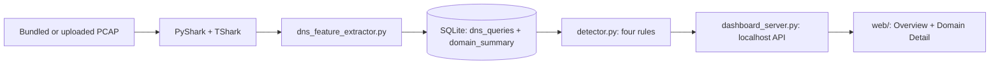
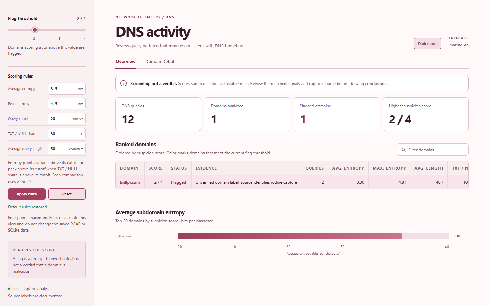

# Rule-based DNS tunneling detector

A four-day information security course project that turns real DNS packet captures into SQLite data, scores domains with four explainable rules, and displays the results in a local HTML dashboard. Upload a PCAP in the sidebar to run the same extraction and view its results immediately. It uses PyShark with TShark and **no machine learning**.

## Project layout

```text
dns_feature_extractor.py   Stable PCAP -> SQLite CLI
detector.py                Stable four-rule scoring CLI
dashboard_server.py        Stable localhost dashboard CLI
pcap_sqlite/               Python implementations and shared project paths
web/index.html             Standalone dashboard page
web/assets/                CSS, JavaScript, favicon
data/normal.pcap            Required general DNS comparison capture
data/tunneling.pcap         Required source-labeled DNSCAT C2 capture
data/additional/            Eight comparison PCAPs with documented provenance
data/uploads/               Local user uploads (created on demand, ignored by Git)
data/SOURCES.md             Exact provenance, hashes, and label limits
output/normal.db            SQLite analysis of the comparison capture
output/tunneling.db         SQLite analysis of the primary tunnel capture
output/additional/          SQLite analyses of the extra captures
output/uploads/             SQLite analyses of local uploads (ignored by Git)
docs/screenshots/           Dashboard image embedded in the report
.codex/                    Project brief and verified handoff
report.md                  Course report
```

The ten bundled PCAPs, SQLite databases, report image, and application code are included in this repository. The root Python scripts remain the course CLI commands; their implementation is organized in `pcap_sqlite/`. The local `.venv/` and portable TShark copy are excluded; install TShark separately after cloning. Third-party capture provenance is in [data/SOURCES.md](data/SOURCES.md). Current project instructions and verified state are in [.codex/prompt.md](.codex/prompt.md) and [.codex/handoff.md](.codex/handoff.md).



## Setup on Windows PowerShell

Install Python 3.14 or a compatible Python 3 release and Wireshark with TShark. Make `tshark.exe` available on `PATH`, set `TSHARK_PATH`, or pass `--tshark` to the extraction command. From the repository root:

```powershell
python -m venv .venv
Set-ExecutionPolicy -Scope Process -ExecutionPolicy RemoteSigned
& .\.venv\Scripts\Activate.ps1
python -m pip install --upgrade pip
python -m pip install -r requirements.txt
tshark --version
```

SQLite comes with Python. The bundled databases let you view results immediately; TShark is needed when rebuilding them from the PCAPs.

## Run the dashboard

```powershell
python dashboard_server.py
```

Open <http://127.0.0.1:8501/>. The server listens on localhost. Select any of the ten bundled captures in the sidebar. **Overview** shows query and domain counts, a searchable ranked table, and an entropy chart. **Domain Detail** explains the four rule hits, DNS query trace, type mix, and query frequency over time. The flag-threshold slider changes the displayed status only.

The sidebar's **Scoring rules** fields let you edit all five cutoffs and apply them to the current analysis. The server recalculates the four rule points, scores, and flags from the saved SQLite features; the PCAP and database are not rewritten. The adjusted rules carry over when you select another capture during that page session. **Reset defaults** restores the course thresholds; a page reload also restores them. The header button switches between dark and light maroon themes, and remembers the theme in this browser.



To analyze your own capture, choose a `.pcap`, `.pcapng`, or `.cap` file under **Analyze a PCAP** and select **Extract and analyze**. TShark must be installed or pointed to by `TSHARK_PATH`. The server accepts up to 25 MiB and checks the capture magic bytes. It saves the original to `data/uploads/`, extracts query rows and domain summaries through PyShark, writes both required tables to `output/uploads/`, and selects the new database. Uploaded captures have no ground-truth label; review their provenance separately. These upload directories are local and ignored by Git. On a fresh clone without TShark, bundled results remain viewable but upload/extraction returns a clear error.

## Rebuild and score the databases

The two required course captures:

```powershell
python dns_feature_extractor.py --pcap data/normal.pcap --db output/normal.db
python dns_feature_extractor.py --pcap data/tunneling.pcap --db output/tunneling.db
python detector.py --db output/normal.db
python detector.py --db output/tunneling.db --known-malicious example.attack
```

The five earlier tool captures:

```powershell
python dns_feature_extractor.py --pcap data/additional/tunneling_dns2tcp.pcap --db output/additional/dns2tcp.db
python dns_feature_extractor.py --pcap data/additional/tunneling_dnscat2_12_queries.pcap --db output/additional/dnscat2.db
python dns_feature_extractor.py --pcap data/additional/tunneling_dnsextrator.pcap --db output/additional/dnsextrator.db
python dns_feature_extractor.py --pcap data/additional/tunneling_iodine.pcap --db output/additional/iodine.db
python dns_feature_extractor.py --pcap data/additional/tunneling_sods.pcap --db output/additional/sods.db
python detector.py --db output/additional/iodine.db
```

Three added comparison captures:

```powershell
python dns_feature_extractor.py --pcap data/additional/ctu_normal_4_dns.pcap --db output/additional/ctu_normal_4_dns.db
python dns_feature_extractor.py --pcap data/additional/korving_dns2tcp_key.pcap --db output/additional/korving_dns2tcp_key.db
python dns_feature_extractor.py --pcap data/additional/korving_dns2tcp_txt.pcap --db output/additional/korving_dns2tcp_txt.db
```

Each run stores one row per DNS **query** in `dns_queries` and one summary per base domain in `domain_summary`. The detector awards four possible points: entropy (average > 3.5, or maximum > 4.5 with TXT/NULL ratio > 0.3), query count > 20, TXT/NULL ratio > 0.3, and average query length > 50. A score of at least 2 is flagged for review. Its base-domain splitter uses the last two labels, so names under multi-part public suffixes may be grouped incorrectly. The CLI accepts repeatable `--known-malicious` and `--known-benign` labels; flagged domains without either label are reported as unverified, not false positives.

## Observed results

| Capture | DNS queries | Domains | Score of observed domain | Flagged at 2/4? |
| --- | ---: | ---: | ---: | --- |
| Wireshark general DNS | 19 | 7 | All 0/4 | No |
| DNSCAT C2 scenario | 438 | 1 | `example.attack` 4/4 | Yes |
| dns2tcp | 22 | 1 | `hsc.fr` 4/4 | Yes |
| dnscat2 short sample | 12 | 1 | `biillpi.com` 2/4 | Yes |
| DNSExfiltrator | 14 | 1 | `hsc.fr` 3/4 | Yes |
| iodine | 12 | 1 | `biillpi.com` 2/4 | Yes |
| sods | 493 | 1 | `hsc.fr` 4/4 | Yes |
| CTU normal DNS | 3,029 | 112 | Highest 1/4 | No |
| DNS2TCP KEY scenario | 376 | 2 | `example.attack` 2/4 | Yes |
| DNS2TCP TXT scenario | 457 | 4 | `example.attack` 3/4; `powerdns.com` 3/4 | Both flagged; `powerdns.com` unverified |

The scenario labels come from their source repositories, not the detector. The Wireshark sample is not independently labeled benign. The CTU dataset has a source-level normal description, but not per-domain benign labels. These captures do not establish a general accuracy or false-positive rate. The revised entropy rule catches this iodine example; it is not evidence of general recall. The dashboard marks `powerdns.com` as unverified despite its flag. See [report.md](report.md) for the course explanation and [data/SOURCES.md](data/SOURCES.md) for original download links and hashes.

## Checks and local API

```powershell
python -m unittest discover -s tests -v
node --check web/assets/app.js
python -m py_compile dns_feature_extractor.py detector.py dashboard_server.py
```

The dashboard uses a localhost-only API: `GET /api/health`, `GET /api/databases`, `GET /api/analysis?db=<id>&threshold=<1..4>`, and `POST /api/upload` with raw PCAP bytes plus a URL-encoded `X-Filename` header. The analysis endpoint also accepts optional `avg_entropy`, `max_entropy`, `query_count`, `txt_null_ratio` (fraction from 0 to 1), and `avg_query_len` parameters. Omitting them uses the constants in `pcap_sqlite/detector.py`; omitting `threshold` uses 2. The analysis response supplies rule values, score range, domain scores, and server-calculated flags. Invalid requests return JSON with `error` and `code`. There is no user login because the server is bound to `127.0.0.1`; do not expose it on a public interface. The server serves only `/`, `/index.html`, and the allowlisted `/assets/` files under `web/`.
