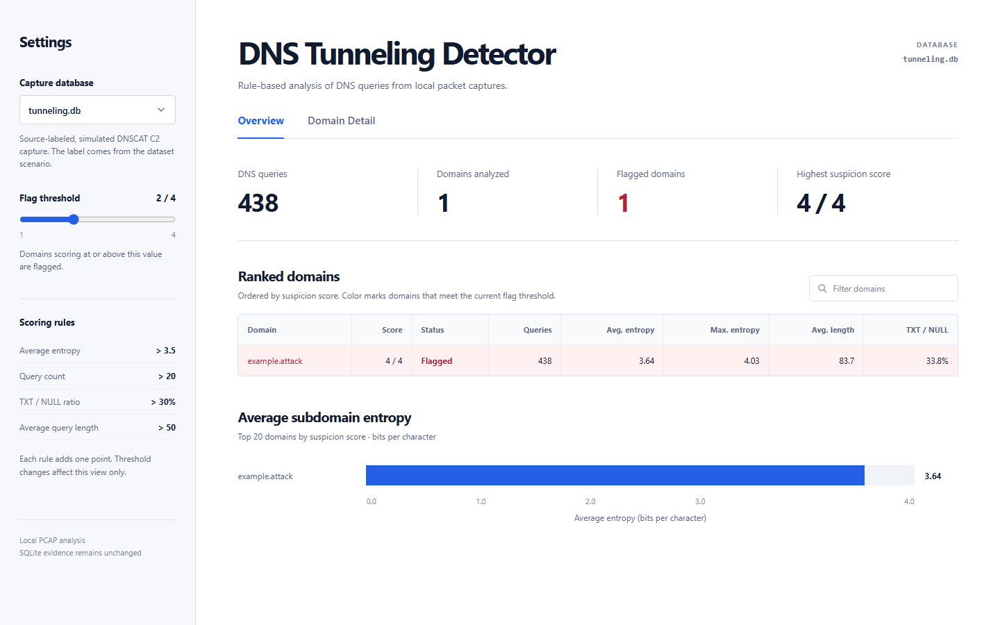

# DNS tunneling detection from PCAP to SQLite

## Problem and method

DNS tunneling can hide data transfer in repeated DNS queries with long, encoded-looking subdomains. This project provides a small, explainable rule-based detector for local captures. Its **mandatory PCAP Analysis module** is a real PCAP-to-SQLite pipeline: PyShark reads packets through TShark, `dns_feature_extractor.py` keeps DNS queries, and pandas writes the query-level `dns_queries` and per-domain `domain_summary` tables. No synthetic traffic or machine learning is used in the reported run.

Each query records its name, name length, query type, timestamp, base domain, and Shannon entropy of the labels before that base domain. Each domain summary records query count, mean and maximum entropy, distinct query-type count, mean name length, and the fraction of TXT/NULL queries. The detector awards one point for each strict condition: mean entropy > 3.5, query count > 20, TXT/NULL fraction > 0.3, and mean name length > 50. Scores range from 0 to 4; scores of at least 2 are flagged for review. High entropy and long names can suggest encoded payloads; many requests and TXT/NULL usage can suggest sustained transfer. None is conclusive alone.

## Verified run

| Capture | DNS queries in SQLite | Domain summaries | Detector result |
| --- | ---: | ---: | --- |
| Wireshark general DNS sample (`normal.pcap`) | 19 | 7 | No domains flagged; each scored 0/4 |
| Simulated DNSCAT C2 scenario (`tunneling.pcap`) | 438 | 1 | `example.attack` flagged at 4/4 |
| dns2tcp tool capture | 22 | 1 | `hsc.fr` flagged at 4/4 |
| Short dnscat2 tool capture | 12 | 1 | `biillpi.com` flagged at 2/4 |
| DNSExfiltrator tool capture | 14 | 1 | `hsc.fr` flagged at 3/4 |
| iodine tool capture | 12 | 1 | `biillpi.com` scored 1/4; **not flagged** |
| sods tool capture | 493 | 1 | `hsc.fr` flagged at 4/4 |

For `example.attack`, the observed mean entropy was 3.640, mean query length 83.7 characters, and TXT/NULL fraction 33.8%. Its 438 queries included 144 CNAME, 146 MX, and 148 TXT questions. All seven databases contain the required tables. The primary dashboard is written in HTML, CSS, and JavaScript; a small read-only Python server supplies its data from SQLite on localhost and lets users compare all seven captures. The original Streamlit `dashboard.py` remains available for the approved course deliverable.

## Ground truth and limits

The tunnel labels come from the source repositories' controlled tool scenarios, not from detector predictions. Wireshark describes the comparison capture as various DNS lookups; it does **not** provide independent benign labels for every domain. Therefore “0 flagged” is an observed result, not a measured false-positive rate. The five additional captures come from one repository, several are very short, and they share only a few domains. They are not a representative accuracy benchmark. See [data/SOURCES.md](data/SOURCES.md) for exact provenance and hashes.

The iodine capture is a concrete miss at the default 2/4 threshold: its 12 queries score 1/4. The fixed heuristics can miss low-volume tunnels or flag legitimate high-entropy services. Query length uses the visible DNS name, and the base-domain splitter takes the last two labels, so multi-part public suffixes may be grouped incorrectly. Encrypted DNS and traffic absent from the capture cannot be analyzed. The dashboard reads local SQLite offline; changing its flag threshold changes the view, not the stored evidence.
